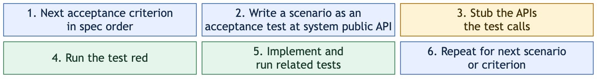

# Lean TDD for OpenSpec

[Brian Okken's Lean TDD](https://leantdd.com/) applies Lean principles to test-driven development: focus on valuable behavior and useful feedback while removing duplicated tests and other wasted effort.

This OpenSpec schema turns that approach into a workflow. The spec is an ordered list of user-facing acceptance criteria, and each scenario is one acceptance test at the system public API. Tasks follow the criteria in spec order. For each scenario, write the test, stub the APIs it calls, see it fail, and implement everything it needs. Only the acceptance tests are written; the APIs they call are covered through them.

## Start a change

With the [OpenSpec CLI](https://github.com/Fission-AI/OpenSpec), Node.js, and git installed, run one command from your OpenSpec project. npx fetches the [openspec-schemas](../../README.md) catalog from its [Git remote](https://github.com/jieli-matrix/openspec-schemas.git):

```sh
npx github:jieli-matrix/openspec-schemas new lean-tdd your-openspec-change
```

Replace `your-openspec-change` with the name of the change you want to create. The command copies `openspec/schemas/lean-tdd/` into your project if no project or user-level copy exists, and runs `openspec new change <name> --schema lean-tdd`. It leaves your project's default schema alone. Add `--dir <path>` to target another project. To install the schema without starting a change, use `install lean-tdd` instead of `new lean-tdd …`.

After trying a change, set `schema: lean-tdd` in your project's `openspec/config.yaml` if you want it as the default. [`examples/config.yaml`](examples/config.yaml) shows the minimal setting.

## How the loop works



This to-do list example is adapted from [Brian Okken's *Lean TDD: TDD Without the Waste*](https://leantdd.com/). For the criterion **Adding an item increases the count**, write its First item scenario as a pytest test:

```python
from todo_list import TodoList


# Adding an item increases the count / First item
def test_adding_an_item_increases_count():
    items = TodoList()
    assert items.count() == 0
    assert items.empty()

    items.add_item("buy milk")

    assert items.count() == 1
    assert not items.empty()
```

The test calls two other public methods: `count()` to observe the number of items and `empty()` to observe whether the list has any. They are not separate requirements and get no tests of their own. Design reviews them as part of the `TodoList` interface; stub all three so the test runs, see it fail, then implement them until it passes. The second scenario, Another item, makes sure a hardcoded `count()` cannot pass. See the [spec](examples/sample-change/specs/todo-items/spec.md), [design](examples/sample-change/design.md), and [tasks](examples/sample-change/tasks.md) for the complete example.

Requirement headings carry plain outcome names. `AC-1`, `AC-2`, and so on are positions within one change and appear only in its `tasks.md`, so the main spec stays readable after archive.

The [testing trophy](https://kentcdodds.com/blog/the-testing-trophy-and-testing-classifications) helps choose the test boundary for each criterion: the system public API usually exercises the interacting parts. A focused lower-level test is an exception for complex logic the acceptance test cannot isolate. The schema does not require a UI harness or a test ratio.

Passing tests do not show where knowledge lives, so design.md reviews the change as module boundaries. It opens with one line on the complexity the change adds and removes. It then starts with the public API the acceptance tests call and adds only the internal boundaries that matter. For each, it shows how a caller uses it, what it hides, the concept it presents, and which layer owns the specific details. Boundaries get no tests of their own; the acceptance tests cover them. The to-do example has one boundary, the public `TodoList`, and no internal ones.

## Attribution and license

The Lean TDD approach and original to-do list example come from [*Lean TDD: TDD Without the Waste*](https://leantdd.com/) by Brian Okken. The book and its original examples are © 2026 Brian Okken. This repository is an independent adaptation of those ideas for OpenSpec; its maintainer is not the book's author. The module-boundary review follows David Parnas's information hiding and John Ousterhout's *A Philosophy of Software Design*.

The schema is forked from OpenSpec's `spec-driven` schema at [`79b6aa9`](https://github.com/Fission-AI/OpenSpec/commit/79b6aa9c98f1e36795b2bc4ef2a8f770c6d3a777). The artifact IDs, artifact graph, apply tracking, and proposal artifact are unchanged. This repository is MIT licensed; see [LICENSE](../../LICENSE). That license does not license the book.

For the adaptation's background, see the [Lean TDD working model](explorations/lean-tdd-insights.md) and [schema options](explorations/lean-tdd-schema-options.md).
